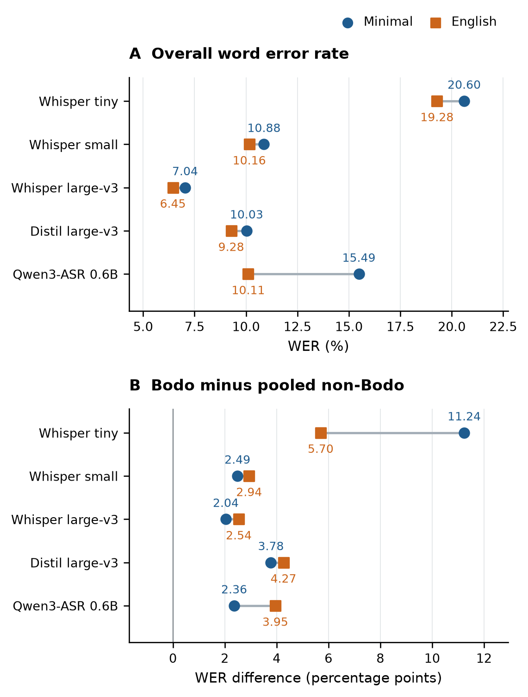
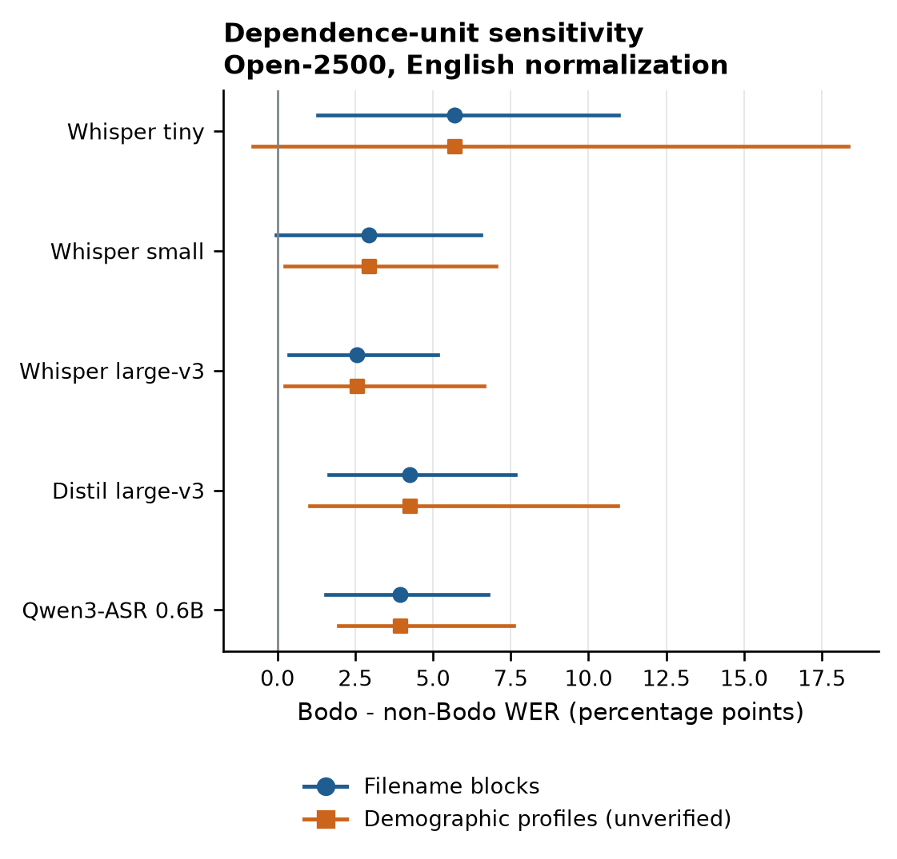

# Which Indian-Accent Disparities Survive Evaluation Choices?

## A Replication and Reliability Study on Svarah

Anonymous authors

## Abstract

Indian-English speech recognition benchmarks already document differences across native-language groups. We examine their sensitivity to sampling, text normalization, and available dependence information. Our retrospective Svarah audit compares six recognizers on an identical 450-utterance panel and reanalyzes five open recognizers on 2,500 historical utterances. On the historical panel, symmetric English normalization changes Qwen's apparent 4.61-percentage-point WER deficit against Whisper-small to a 0.05-point difference, while increasing Qwen's Bodo-versus-others gap from 2.36 to 3.95 points. On the matched panel, five systems have positive Bodo gaps under both normalizers; Whisper-small has a negative gap, with one repetitive Tamil output contributing 32.21% of its Minimal errors. Bodo's worst-coarse-group status on the historical panel does not consistently identify the worst individual native language. Missing verified speaker identifiers prevent calibrated speaker-population inference, and available blocking partitions yield materially different diagnostic spans. These results show how aggregate model comparisons and subgroup conclusions can change in different directions under the same evaluation choices. The accompanying artifact preserves raw outputs, scoring counts, and provenance so those choices remain inspectable.

## 1. Introduction

A low word error rate (WER) on Indian-English speech does not describe how errors are distributed across speakers. This observation is established, including within India: the original Svarah benchmark reports native-language breakdowns and finds that several models perform poorly on Assamese, Bodo, and Nepali speech [1]. The question for a new audit is therefore more specific: when recognizers improve and evaluation choices change, which previously observed disparities remain supported?

This question requires more than adding model rows to a leaderboard. Different utterance samples can confound a model comparison. Written forms such as digits and spelled-out numbers can change edit counts without changing the recognized information. Pooling many native languages into a few families changes which differences remain visible. Finally, thousands of utterances may supply far fewer independent observations when the same speakers contribute repeatedly [2,3]. A small p-value from a model that ignores this dependence does not resolve those issues.

We examine these problems through a retrospective Svarah audit. The systems span three Whisper sizes, Distil-Whisper large-v3, Qwen3-ASR-0.6B, and a stored Saaras V3 API snapshot. The primary comparison uses identical utterances for all systems. A larger historical panel supplies a sensitivity analysis for the five open recognizers. Both panels are scored under a replicated minimal normalizer and a Whisper English normalizer. We report observed group differences, not a binary label of a system as fair or unfair.

Our contributions are: (i) a matched comparison that includes an India-focused commercial recognizer and newer open checkpoints; (ii) an empirical test of the stability of native-language disparities under scoring and aggregation choices; and (iii) an explicit account of how sampling support and available identifiers limit statistical claims. The work extends an existing benchmark and established inference methods.

## 2. Related work

Svarah introduced a diverse Indian-English benchmark and compared open and commercial systems, including WER for 19 native-language groups [1]. ASR-FAIRBENCH combines accuracy and fairness measurements using a mixed-effects Poisson model on Fair-Speech [4]. Earlier work develops both mixed-effects models for ASR subgroup comparisons [3] and blockwise bootstrap procedures for dependent ASR observations [2]. These studies establish the need to account for confounders and speaker dependence; our analysis applies that concern to the available Svarah artifacts.

Indian clinical ASR has also been audited across systems and speaker subgroups. The preprints ASR Under the Stethoscope and SamaVaani examine role and gender differences and propose a debiasing method, respectively [5,6]. Their clinical setting differs from our native-language analysis.

The public `indian-asr-bench` artifact compares nine recognizers on three corpora, including full Svarah, and documents text-normalization sensitivity, error-tail behavior, and cluster-bootstrap comparisons [7]. Whisper's original evaluation also explicitly addresses formatting differences and the limits of text standardization [9]. We complement these analyses by centering subgroup estimates and their inferential limits in a shared commercial/open panel. The empirical extension includes Saaras V3, Distil-large-v3, and Qwen3-ASR-0.6B, while examining the relationship between Bodo support, coarse grouping, and unavailable speaker identity.

## 3. Evaluation design

### 3.1. Corpus and comparison panels

Svarah contains 9.6 hours of Indian-English speech from 117 speakers and includes read, extempore, and everyday-use-case material [1]. The Hugging Face release used here has 6,656 test utterances and exposes native-language and demographic fields [8]. Its revision is `ebbf7777fe771490696a3f7b007097606fa8c924`.

We distinguish two panels. **Matched-450** uses the 450 utterances in the archived Saaras evaluation and fresh predictions from each open checkpoint. **Open-2500** reuses the same 2,500 utterances already evaluated by all five open systems. The panels share 156 utterances and derive from one corpus; they are not independent replications.

Table 1. Evaluation support. IA and Dr denote the explicit Indo-Aryan and Dravidian groupings in our analysis; Bodo is kept as its own observed native-language label.

| Panel | Systems | IA | Dr | Bodo |
|---|---:|---:|---:|---:|
| Matched-450 | 6 | 150 | 150 | 150 |
| Open-2500 | 5 | 1,673 | 688 | 139 |

The matched panel balances the three coarse groups by utterance count. Its overall WER describes that panel rather than the whole dataset or Indian English speakers generally. Both panels cover all 19 native-language labels: 14 grouped as Indo-Aryan, four as Dravidian, and Bodo. Individual-language support in Matched-450 ranges from two utterances for Konkani to 150 for Bodo. Bodo is the sole label previously aggregated as Sino-Tibetan, so its results do not establish a result for other languages in that family. All individual-language counts and error rates accompany the paper.

### 3.2. Systems and provenance

The open systems are `openai/whisper-tiny`, `openai/whisper-small`, `openai/whisper-large-v3`, `distil-whisper/distil-large-v3`, and `Qwen/Qwen3-ASR-0.6B-hf` [9–13], abbreviated Tiny, Small, Large, Distil, and Qwen. Saaras denotes the archived `saaras:v3` response set from Sarvam's speech-to-text endpoint, with `mode=transcribe` and `language_code=en-IN` [14]. We do not fine-tune any recognizer or supply reference transcripts as decoding context.

Fresh open predictions for Matched-450 use pinned checkpoints and the original evaluation's runtime and decoding configuration. Whisper-family decoding forces English transcription, uses one beam without sampling, and processes each utterance independently. Qwen uses the native transcription request interface with English supplied and extracts only transcription text. Audio is resampled to 16 kHz. The archived Saaras outputs are reused without further API requests. Full generation limits, dependency versions, checkpoint revisions, and hashes are recorded in the run manifests.

On the 156 utterances shared by Matched-450 and Open-2500, all four Whisper-family systems reproduce every historical hypothesis exactly. Qwen reproduces 150 raw hypotheses and 153 after Minimal normalization. We retain these separate execution snapshots rather than splice old and new predictions. Checkpoint and run manifests accompany the stored outputs, which fix the scoring experiment even if an external API or repository later changes.

### 3.3. Text scoring

For utterance i, let E_i = S_i + D_i + I_i be the word-level Levenshtein error count and N_i the number of reference words after normalization. Corpus WER for any set G is 100 × Σ E_i / Σ N_i, with both sums over G. We sum edit counts before dividing; a mean of utterance WERs would give short utterances disproportionate influence.

We score every reference and hypothesis symmetrically under two procedures. **Minimal** reproduces the historical regex-based scoring: lowercasing, replacement of punctuation by spaces while preserving apostrophes and underscores, and whitespace normalization. **Whisper English** applies the pinned English text normalizer and its spelling map, including its number and contraction conventions. The same procedure is used for all systems; no model receives a vendor-specific correction. Both procedures use identical word-alignment logic.

Normalization changes the measurement target and may change both E_i and N_i. A lower score after normalization is not, by itself, improved acoustic recognition. We therefore report cross-normalizer changes as evaluation sensitivity, retain raw transcripts, and avoid choosing the normalizer after seeing which system benefits.

### 3.4. Disparity and uncertainty

The primary observed contrast is G_m = WER_m(Bodo) − WER_m(non-Bodo), in percentage points, for each model m. The pooled comparison group uses its observed word distribution. We also report Bodo–Dravidian, Bodo–Indo-Aryan, and Indo-Aryan–Dravidian contrasts and the max-minus-min WER across the three coarse groups. We call the latter the **three-group WER spread**; it is not demographic parity as that term is used for classification decisions. Individual-language summaries reveal heterogeneity concealed by these aggregates.

This is a retrospective reliability study. The Bodo contrast follows prior benchmark findings and the original audit results, rather than a hypothesis preregistered before any data were observed. Pairing is preserved whenever systems are compared on the same panel. A change in G_m between systems combines their paired performance differences on Bodo and the pooled comparison group; comparing two separately reported significance labels would not test that change.

We reproduce the historical Poisson model, E_i ~ Poisson(μ_i), with log μ_i = log N_i + β_0 + β_group. Its likelihood-ratio comparison with an intercept-only model diagnoses the original procedure. Pearson dispersion is Σ (E_i − μ_i)^2 / μ_i divided by residual degrees of freedom; values well above one indicate overdispersion relative to the fitted model. We do not use these independent-utterance p-values to establish population disparity.

No verified speaker identifiers were recovered from the pinned release, two identical cached original metadata CSVs, or the original manifest. The recovered files were checked against all 6,656 current filenames, transcripts, and durations. We therefore use two available partitions only as blocking sensitivities: filename `fN` tags and exact profiles over eight demographic fields. The latter was added after inspecting initial normalization results and is explicitly post hoc. Neither partition identifies verified speakers. Different people may share a profile, and filename tags may identify multiple recordings from one person.

For each partition, we sample blocks with replacement within native-language strata, using 2,000 replicates and seed 20260909. All utterances in a selected block remain together. The same resampling weights apply across models and normalizers, while word counts are recomputed. We report the 2.5th and 97.5th percentiles as diagnostic spans, conditional on the observed strata and block counts. These are not calibrated confidence intervals for a speaker population, and all hypothesis-test p-values for these partitions are withheld. The accompanying protocol records the analysis choices and amendments.

## 4. Results

### 4.1. Matched comparison

On Matched-450, Saaras has the lowest observed WER under both normalizers: 5.81% under Minimal and 5.08% under Whisper English. Large is next at 6.69% and 6.14%. Five systems have positive Bodo-minus-others gaps under both procedures, but Small has negative gaps of −1.83 and −1.27 points. Thus a claim that Bodo is the worst coarse group for every tested system does not survive the matched comparison.

Table 2. Matched-450 results on identical utterances. M = Minimal; E = Whisper English. WER is percent; gap is Bodo minus pooled non-Bodo WER in percentage points. All outputs, including repetitive decoding, are retained.

| Model | WER M | WER E | Gap M | Gap E |
|---|---:|---:|---:|---:|
| Tiny | 17.18 | 16.98 | 5.37 | 5.93 |
| Small | 13.31 | 13.01 | −1.83 | −1.27 |
| Large | 6.69 | 6.14 | 3.98 | 4.34 |
| Distil | 9.77 | 9.28 | 4.51 | 5.17 |
| Qwen | 14.96 | 10.05 | 4.72 | 5.66 |
| Saaras | 5.81 | 5.08 | 3.06 | 3.14 |

Small's negative Bodo contrast does not imply uniformly accurate recognition: its three-group WER spread is 12.94 points under English scoring, with Dravidian speech having the highest coarse-group WER. One 0.424-second Tamil utterance with the one-word reference “Nila” produces a repetitive 200-word hypothesis, contributing 200 of Small's 621 Minimal errors (32.21%). The clip is absent from Open-2500. Five Small outputs above 100% utterance WER account for 33.49% of its Minimal errors; excluding those five only as a diagnostic changes WER from 13.31% to 8.86%. The main estimates retain them.

### 4.2. Scoring changes the model comparison

On Open-2500, Qwen's WER changes from 15.49% under Minimal scoring to 10.11% under Whisper English scoring. Small changes from 10.88% to 10.16%. Thus the observed Qwen-minus-Small difference changes from +4.61 percentage points to −0.05 points: a substantial apparent deficit becomes a near tie, without changing either model's transcripts. This does not establish Qwen superiority. At the same time, Qwen's Bodo-minus-others gap increases from 2.36 to 3.95 points. Aggregate score improvement and reduced observed disparity are therefore distinct outcomes.

Table 3. Open-2500 scoring sensitivity. M = Minimal; E = Whisper English. WER is percent; gap is Bodo minus pooled non-Bodo WER in percentage points. All models see the same 2,500 utterances.

| Model | WER M | WER E | Gap M | Gap E |
|---|---:|---:|---:|---:|
| Tiny | 20.60 | 19.28 | 11.24 | 5.70 |
| Small | 10.88 | 10.16 | 2.49 | 2.94 |
| Large | 7.04 | 6.45 | 2.04 | 2.54 |
| Distil | 10.03 | 9.28 | 3.78 | 4.27 |
| Qwen | 15.49 | 10.11 | 2.36 | 3.95 |

Qwen's error count falls from 4,067 to 2,669, while the common reference denominator changes from 26,262 to 26,397 words. Its insertions fall from 1,845 to 862. A post hoc partition finds that 275 references containing a digit account for 1,291 of the 1,398 net removed errors (92.35%). On references without digits, Qwen and Small are already close under Minimal scoring (Table 4). This locates the change in the data; it does not isolate numeral handling from the normalizer's other transformations.

Table 4. Descriptive digit-reference partition of Open-2500. Cells show WER (%); M and E denote the two normalizers. Partitioning was selected after observing the overall scoring change.

| Reference subset (n) | Qwen M | Qwen E | Small M | Small E |
|---|---:|---:|---:|---:|
| Contains digit (275) | 51.39 | 14.83 | 18.08 | 15.96 |
| No digit (2,225) | 9.90 | 9.38 | 9.75 | 9.26 |

One illustrative utterance contains reference years “1994 and 2004” and hypothesis years “nineteen ninety four and two thousand four”; its complete-utterance error count changes from six to zero. Conversely, another hypothesis's adjacent spelled-out years become “20212022,” leaving an error against “2021 2022.” The English normalizer is therefore a useful alternative measurement, not semantic ground truth.

Figure 1. Normalization changes overall WER and observed subgroup disparity differently. Both panels use the same historical 2,500 utterances and unchanged transcripts. The lower panel shows Bodo minus pooled non-Bodo WER; values are descriptive point estimates.

### 4.3. Coarse grouping changes the headline

Bodo has the highest WER among the three coarse groups for all five historical open systems under both normalizers. Yet it is never the highest-WER individual native language under Minimal scoring. The highest observed individual-language WER belongs to Dogri for Tiny, Konkani for Small and Qwen, Assamese for Distil, and Nepali for Large. Under English normalization, Bodo is highest only for Distil. Thus “worst coarse group” does not identify a uniformly worst accent. Pooling 14 Indo-Aryan labels averages over differences that remain visible in the 19-language breakdown.

The supplementary native-language heatmap displays all 19 groups with their utterance counts. These descriptive comparisons retain small groups instead of replacing them with a family-level average.

### 4.4. Dependence and limited support

The historical Open-2500 Poisson dispersion estimates range from 2.84 to 22.09 under Minimal scoring and from 2.79 to 23.39 under English scoring. Those values indicate substantial mismatch with an equidispersed count model. The original nominal significance labels consequently provide a poor summary of the evidence.

Open-2500 and Matched-450 contain 1,473 and 326 filename tags, respectively, but only 115 and 92 exact demographic profiles. Bodo contributes five profiles in each panel. The choice of available blocking partition changes the apparent precision materially. For Tiny on Open-2500, the Minimal Bodo-gap span is [0.76, 31.96] points with filename blocks and [−1.45, 42.63] with profile blocks. Under English scoring, the spans are [1.30, 10.96] and [−0.78, 18.36], respectively. These are sensitivity calculations under unverified partitions. Crossing zero does not establish parity, and excluding it does not repair the absent speaker mapping.

Figure 2. Bodo-minus-others gap on Open-2500 under Whisper English scoring. Lines are diagnostic 2.5th–97.5th percentile spans from filename-block and demographic-profile-block resampling. Neither partition supplies verified speaker identifiers, so these spans do not establish speaker-population confidence intervals or significance.

## 5. Discussion

The clearest result is that scoring can remove a large apparent model-performance difference while enlarging a subgroup gap. For Qwen, the lower English-normalized aggregate score accompanies a larger Bodo contrast. Conversely, Tiny's observed contrast nearly halves under the same scoring change. The direction and magnitude of normalization sensitivity are model-dependent, so one aggregate correction factor cannot summarize the audit.

Three distinctions govern interpretation. First, matched-sample ranking is a statement about the chosen panel. Oversampling Bodo makes that group more visible but changes the overall word distribution. Second, normalization stability and statistical certainty are separate: a positive point estimate under both normalizers may still have substantial uncertainty. Third, a coarse family label compresses varied native-language backgrounds. Neither a favorable group mean nor a small three-group spread establishes uniform performance within that group.

Model architecture, training data, capacity, and decoding differ simultaneously across these recognizers. The comparisons therefore cannot identify a causal effect of scale, distillation, or India-focused training. Similarly, native language is a proxy for one source of accent variation and can correlate with lexical content, recording conditions, and other speaker attributes. The analysis measures error associations; it does not attribute each difference to pronunciation.

## 6. Limitations and responsible interpretation

The study uses one existing corpus and fixed model snapshots. The 450-utterance sample is selected for compatibility with archived commercial predictions and coarse-group balance; the 2,500-utterance panel provides additional observations from the same source. Neither supports claims about all Indian English speech. Training-data overlap with the benchmark remains unknown for some systems. Results condition on the specified decoding procedure; alternative decoding, including Whisper's temperature fallback, may alter repetitive outputs. No new human transcription adjudication or controlled acoustic experiment is included. WER also treats errors uniformly despite potentially different effects on names, numbers, and downstream tasks.

The absence of a verified speaker mapping prevents speaker-population inference. The five observed Bodo profiles are neither a verified count of speakers nor enough information to validate a mixed-effects fairness model. Profile and filename partitions expose sensitivity to assumed dependence but cannot resolve it. Recovering an author-verified mapping and adding independent speakers are higher priorities than further resampling the same clips.

Svarah's authors report informed participant consent for collecting speech-model data [1], and its current dataset card specifies CC BY 4.0 [8]. This study collects no new participant data and makes no attempt to identify speakers. The released analysis should retain only the metadata needed for the audit, alongside attribution and instructions for obtaining the source corpus. Observed error differences characterize recognizers on these recordings and do not rank the competence or legitimacy of any accent.

## 7. Reproducibility

The artifact separates transcription from deterministic scoring. The command `bash paper/reproduce.sh` regenerates metadata validation, both blocking analyses, normalization diagnostics, figures, and this document from stored predictions. Dataset and model revisions, evaluated utterance IDs, reference/hypothesis pairs, and normalizer provenance are under `paper/data/`; aggregate numerators, denominators, rates, and contrasts are under `paper/results/`. Historical and fresh predictions remain distinguishable. Scoring requires no raw audio. Validation confirms zero normalization, edit-count, or WER arithmetic mismatches over 15,650 historical and matched result rows.

## 8. Conclusion

The evaluated Svarah disparities are sensitive to how errors are measured and aggregated. Normalization removes Qwen's large apparent deficit against Small on the historical panel while enlarging its Bodo contrast. Matching all six systems exposes a counterexample to an all-systems Bodo-worst claim, and individual-language results further qualify coarse-group rankings. These observations support explicit reporting of the evaluated sample, symmetric normalization, error concentration, and native-language support. They do not resolve speaker-population uncertainty: obtaining verified speaker mappings and independent recordings remains necessary for stronger generalization.

## References

[1] T. Javed et al. “Svarah: Evaluating English ASR Systems on Indian Accents.” Interspeech, pp. 5087–5091, 2023. [Paper](https://www.isca-archive.org/interspeech_2023/javed23_interspeech.pdf).

[2] Z. Liu and F. Peng. “Statistical Testing on ASR Performance via Blockwise Bootstrap.” Interspeech, pp. 596–600, 2020. [Paper](https://www.isca-archive.org/interspeech_2020/liu20c_interspeech.pdf).

[3] Z. Liu, I.-E. Veliche, and F. Peng. “Model-Based Approach for Measuring the Fairness in ASR.” ICASSP, pp. 6532–6536, 2022. [Publication](https://doi.org/10.1109/ICASSP43922.2022.9747654); [author manuscript](https://arxiv.org/abs/2109.09061).

[4] A. Rai, S. Rahangdale, U. Anand, and A. Mukherjee. “ASR-FAIRBENCH: Measuring and Benchmarking Equity Across Speech Recognition Systems.” Interspeech, pp. 298–299, 2025. [Paper](https://www.isca-archive.org/interspeech_2025/rai25_interspeech.pdf).

[5] S. Kumar et al. “ASR Under the Stethoscope: Evaluating Biases in Clinical Speech Recognition across Indian Languages.” arXiv:2512.10967, 2025. [Preprint](https://arxiv.org/abs/2512.10967).

[6] S. Kumar et al. “SamaVaani: Auditing and Debiasing Multilingual Clinical ASR for Indian Languages.” arXiv:2606.26901, 2026. [Preprint](https://arxiv.org/abs/2606.26901).

[7] S. Sharma. “indian-asr-bench.” Public code and benchmark artifact, accessed September 9, 2026. [Repository](https://github.com/theshivam7/indian-asr-bench).

[8] AI4Bharat. “Svarah dataset card.” Hugging Face, revision `ebbf7777fe771490696a3f7b007097606fa8c924`, accessed September 9, 2026. [Dataset card](https://huggingface.co/datasets/ai4bharat/Svarah/blob/ebbf7777fe771490696a3f7b007097606fa8c924/README.md).

[9] A. Radford, J. W. Kim, T. Xu, G. Brockman, C. McLeavey, and I. Sutskever. “Robust Speech Recognition via Large-Scale Weak Supervision.” ICML, PMLR 202, pp. 28492–28518, 2023. [Paper](https://proceedings.mlr.press/v202/radford23a.html).

[10] OpenAI. “Whisper large-v3 model card.” Accessed September 9, 2026. [Model card](https://huggingface.co/openai/whisper-large-v3).

[11] S. Gandhi, P. von Platen, and A. M. Rush. “Distil-Whisper: Robust Knowledge Distillation via Large-Scale Pseudo Labelling.” arXiv:2311.00430, 2023. [Preprint](https://arxiv.org/abs/2311.00430); [distil-large-v3 model card](https://huggingface.co/distil-whisper/distil-large-v3).

[12] X. Shi et al. “Qwen3-ASR Technical Report.” arXiv:2601.21337, 2026. [Report](https://arxiv.org/abs/2601.21337).

[13] Qwen Team. “Qwen3-ASR-0.6B-hf model card.” Accessed September 9, 2026. [Model card](https://huggingface.co/Qwen/Qwen3-ASR-0.6B-hf).

[14] Sarvam AI. “Introducing Saaras V3.” February 10, 2026; accessed September 9, 2026. [Official description](https://www.sarvam.ai/blogs/asr).
