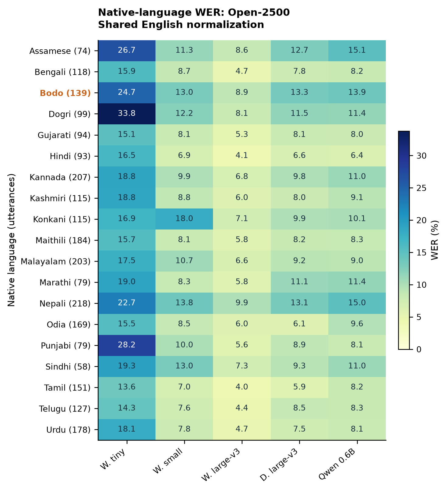

# Supplementary Material

## Which Indian-Accent Disparities Survive Evaluation Choices?

Anonymous authors

## S1. Individual native-language results

Figure S1. Corpus WER for each of the 19 native-language labels in Open-2500, under Whisper English normalization. Each row label includes its number of evaluated utterances. Columns correspond to Whisper tiny, small, and large-v3; Distil-Whisper large-v3; and Qwen3-ASR-0.6B. These are descriptive rates, without significance annotations. Unequal word and speaker support limits comparison across rows.

The main manuscript's three-group analysis uses the following explicit mapping. The mapping is an aggregation choice; it does not imply homogeneous pronunciation within a language family or within any native-language label.

| Analysis group | Observed native-language labels |
|---|---|
| Indo-Aryan | Assamese, Bengali, Dogri, Gujarati, Hindi, Kashmiri, Konkani, Maithili, Marathi, Nepali, Odia, Punjabi, Sindhi, Urdu |
| Dravidian | Kannada, Malayalam, Tamil, Telugu |
| Bodo | Bodo |

The accompanying `paper/results/metrics.csv` gives every corpus, coarse-group, and native-language rate with the numerator, denominator, utterance count, and available-block support. `paper/results/contrasts.csv` records the fixed subgroup and paired model contrasts. Individual-language rates are not selectively tested after sorting by WER.

## S2. Frozen model and scoring configuration

Fresh Matched-450 predictions were generated using the following checkpoint revisions. The prefixes below identify the full 40-character revisions stored in `paper/data/model_revisions.json` and each inference manifest.

| Abbreviation | Checkpoint | Revision prefix |
|---|---|---|
| Tiny | openai/whisper-tiny | 169d4a4341b3 |
| Small | openai/whisper-small | 973afd24965f |
| Large | openai/whisper-large-v3 | 06f233fe06e7 |
| Distil | distil-whisper/distil-large-v3 | 8031d2e6ce66 |
| Qwen | Qwen/Qwen3-ASR-0.6B-hf | 7f1569a48a89 |

The fresh runs use NVIDIA T4 GPUs, float32 weights and inputs, batch size four, PyTorch 2.13.0, and Transformers 5.16.1. Whisper-family generation has one beam, no sampling, English transcription, and a 200-token output limit. Qwen has no sampling, supplied English language, and a 256-token limit. The dataset revision is `ebbf7777fe771490696a3f7b007097606fa8c924`; row identities were checked against stored references and metadata before reuse.

The CPU scoring implementation uses Transformers 4.57.6 for `EnglishTextNormalizer`, independently of the inference runtime. Its spelling map comes from the pinned Large checkpoint. The complete map's SHA-256 is `bf1c507dc8724ca9cf9903640dacfb69dae2f00edee4f21ceba106a7392f26dd`. The Minimal normalizer applies lowercase, replaces characters matched by `[^\w\s']` with spaces, and collapses whitespace. Unicode word characters include underscores. The Minimal rule reproduces all 25,900 stored reference/hypothesis normalization strings across the historical six-system files.

Scoring retains every hypothesis insertion, including utterances with WER above 100%. If a normalizer creates an empty reference, its hypothesis insertions remain in the corpus numerator; undefined utterance ratios are not averaged. The normalization-example artifact contains raw and transformed strings and changed edit counts. Its examples illustrate effects of the combined normalization procedure and are not a controlled ablation of its individual transformations.

The post hoc digit-reference analysis and ordered WER-change decomposition are stored in `paper/results/error_sensitivity.json`. It partitions utterances by whether their raw reference contains a digit; it does not classify the cause of each error. On Open-2500, replacing Qwen's error count while holding the Minimal denominator fixed changes WER by −5.323 points; replacing the denominator afterward contributes −0.052 points, for a total −5.375-point change. This decomposition depends on the stated order. The shared denominator's contribution to the Qwen-minus-Small contrast is negligible, so that contrast's near disappearance is driven by changed edit counts rather than denominator inflation.

## S3. Metadata and blocking sensitivity

The original corpus paper reports 117 participants. We could not recover their row-level speaker mapping. The pinned Hub schema, two identical cached original metadata CSVs, and the original manifest lack speaker identifiers. All recovered original filenames, texts, and durations match the 6,656 pinned Hub rows. The original README describes a speaker field and a public issue reports its absence, so the audit's finding is limited to the files recovered and verified here. It does not establish that no mapping exists elsewhere.

| Panel | Filename fN tags | Numeric prefixes | Exact profiles |
|---|---:|---:|---:|
| Full test split | 3,232 | 2,938 | 115 |
| Open-2500 | 1,473 | 1,393 | 115 |
| Matched-450 | 326 | 324 | 92 |

The profile partition uses exact equality of gender, age group, native language, native state, native district, qualification, job category, and occupation domain. Its identifiers are hashes of observed fields rather than identities inferred from voice. Bodo has five such profiles in both panels. Different people may share these attributes, and metadata inconsistency could split one person's observations. Accordingly, profile-block spans are an exploratory sensitivity, never a substitute for speaker-based intervals. The choice to add this partition was recorded after initial normalization results were observed.

The analysis uses the same block-resampling weights for all models and both normalizers within each panel. The number of sampled blocks within each native-language stratum is fixed; its resulting utterance and word shares can vary. Each replicate recomputes error totals, reference-word totals, and contrasts. All corresponding hypothesis-test p-values are absent because neither available partition identifies verified independent speakers.

Metadata extraction and validation details are in `paper/metadata/README.md` and `paper/data/metadata_validation.json`. The main filename-block analysis is in `paper/results/analysis.json`; demographic-profile sensitivity is in `paper/results/demographic_profile/analysis.json`. These files explicitly label the clustering assumptions and preserve the full analysis options.

## S4. Repetitive-output sensitivity in Matched-450

For Whisper-small, utterance `svarah_05895` has a recorded duration of 0.42425 seconds, native-language label Tamil, and the one-word reference “Nila.” The stored hypothesis repeats a short phrase into a 200-word output. Minimal alignment gives one substitution and 199 insertions: 200 of the panel's 621 Small errors (32.21%). The clip is absent from Open-2500. This is a description of the reference, hypothesis, and edit counts; no audio-based adjudication of its intended words was performed.

The primary results retain every output. Excluding all five Small rows with utterance WER greater than 100% changes its corpus score from 13.31% to 8.86% under Minimal normalization and from 13.01% to 8.59% under Whisper English. This sensitivity illustrates error concentration and is not an alternative cleaned leaderboard. The threshold alone does not identify repetitive decoding: spelled-out numbers against a digit reference can also produce ratios above 100%.

## S5. Primary-source documentation

T. Javed et al. “Svarah: Evaluating English ASR Systems on Indian Accents.” Interspeech, 2023. [Paper](https://www.isca-archive.org/interspeech_2023/javed23_interspeech.pdf).

AI4Bharat. Svarah metadata documentation. [Original README](https://github.com/AI4Bharat/Svarah/blob/2c644dc4f67da2aae63a0bd9ceb2c6f8679ff05c/README.md); [pinned dataset card](https://huggingface.co/datasets/ai4bharat/Svarah/blob/ebbf7777fe771490696a3f7b007097606fa8c924/README.md); [reported missing-speaker-ID issue](https://github.com/AI4Bharat/Svarah/issues/4).

Model references and primary papers appear in the main manuscript. The provenance manifests identify the concrete artifacts used, rather than relying on mutable documentation alone.
