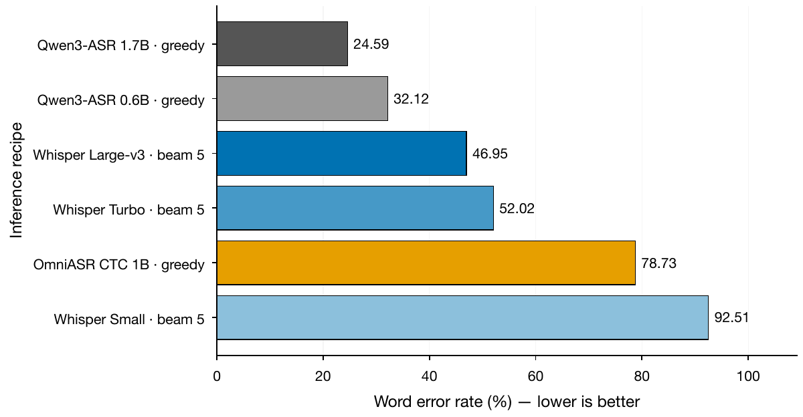

> **Audio QC correction (2026-09-22):** Five public files contain transcript text over exactly silent audio. Affected Assamese/Bengali quality comparisons and aggregates containing them are withdrawn pending adjudication. Original metrics below are preserved as historical records. See the [source-verified audit](artifacts/audio_content_audit/RESULTS.md).

# Open ASR benchmark execution — 22 September 2026

> Follow-up: native-decoder controls and the separate HF GPU budget are documented in [HF_EXECUTION_20260922.md](HF_EXECUTION_20260922.md) and [the validated 22-conversation comparison](artifacts/native_expansion_comparison/RESULTS.md). The budget/shutdown section below describes the earlier ten-attempt snapshot, not current authorization.

Prepared for **C. Kaustubh**. Six open-model inference recipes completed on a frozen public Humyn corpus. This delivers reproducible predictions and an independent benchmark pilot; it does not establish a new ASR method or a publication-ready leaderboard.

## What completed

- **83 model–conversation evaluations**, using 30 distinct conversations across 12 language labels (7.164 hours of unique audio).
- Whisper Small and Turbo: the same 22 conversations across nine languages (5.302 hours each).
- OmniASR CTC 1B: all 30 conversations passing the pre-run structural checks.
- Qwen3-ASR 0.6B, Qwen3-ASR 1.7B, and Whisper Large-v3: the same three Hindi development conversations. Other language/model cells were not evaluated.
- Seven of 37 released conversations were excluded before inference because reference timestamps exceeded audio duration. These are structural warnings, not proof that all their text is wrong. All Punjabi files were affected, so Punjabi has no scored results.
- All seven input artifact directories pass independent checks of hashes, cohort completeness, chunk coverage, token evidence, concatenation and recomputed metrics. The two disjoint Turbo shards merge into one recipe.

No training, reference-guided segmentation, SPIRE held-out access, paid API transcription, or private dataset redistribution was used. The public release is not confirmed to be the exact BRIDGE scored corpus. These scores must not be placed beside Humyn's closed-model leaderboard as a matched comparison.

## Matched Hindi development results

Three conversations, 43.9167 minutes, 6,503 reference words, 89 audio-clock windows per recipe. Lower WER/CER is better. The three files were already used for decoder selection; they are development evidence, not an untouched test set.

| Recipe | WER | CER | Windows without EOS |
|---|---:|---:|---:|
| Qwen3-ASR 1.7B | 24.59% | 20.23% | 0/89 |
| Qwen3-ASR 0.6B | 32.12% | 26.46% | 0/89 |
| Whisper Large-v3 | 46.95% | 39.30% | 10/89 |
| Whisper Turbo | 52.02% | 43.23% | 4/89 |
| OmniASR CTC 1B | 78.73% | 71.06% | N/A (CTC) |
| Whisper Small | 92.51% | 77.47% | 57/89 |

Whisper uses float32, beam 5, batch 8 and at most 440 new tokens. Qwen uses BF16, greedy decoding, batch 8 and at most 512 tokens. Omni uses BF16 CTC, batch 1, with no EOS or generation limit. Each uses fixed, non-overlapping 30-second audio windows and one inference seed (12). This compares complete recipes, not isolated model size, precision, architecture or deployment hardware. No statistical intervals are reported for the three Hindi conversations.

The source figure is available as [PDF](artifacts/expanded_benchmark/hindi_recipes.pdf), [SVG](artifacts/expanded_benchmark/hindi_recipes.svg), and a [reproduction script](plot_expansion.py).

## Per-language multilingual comparison

Each row compares exactly the same conversations for models with numbers in that row. Dashes mean not evaluated, never zero error. WER is pooled word errors divided by reference words within that language; scripts and written numbers are preserved by the frozen scorer. WER may exceed 100% because insertions count as errors.

| Language | Conversations | Whisper Small WER | Whisper Turbo WER | Omni CTC WER |
|---|---:|---:|---:|---:|
| Assamese | 2 | 101.13% | 99.85% | 82.01% |
| Bengali | 3 | 100.00% | 98.67% | 93.81% |
| Bhojpuri | 2 | — | — | 83.59% |
| Chhattisgarhi | 3 | — | — | 97.13% |
| Gujarati | 3 | 100.00% | 93.14% | 67.89% |
| Haryanvi | 3 | — | — | 99.78% |
| Hindi | 3 | 92.51% | 52.02% | 78.73% |
| Kannada | 3 | 105.76% | 86.76% | 60.25% |
| Malayalam | 2 | 100.00% | 160.39% | 93.85% |
| Marathi | 1 | 94.49% | 86.67% | 92.63% |
| Tamil | 2 | 96.01% | 99.39% | 86.54% |
| Telugu | 3 | 99.99% | 95.12% | 97.59% |

There is no pooled leaderboard across unequal language coverage. The 22 shared conversations support an exploratory paired analysis, but only one to three conversations per language and unknown cross-file speaker overlap make population or fairness conclusions unwarranted.

The JSON supplement contains language-stratified conversation-bootstrap intervals (2,000 resamples, seed 20260922). Its estimand is the **unweighted mean paired conversation WER/CER difference**, not a difference between pooled micro-WERs or an equally weighted language mean. These post-run exploratory intervals are descriptive, include the Hindi development files, and have no p-values or significance claims. Treating conversations as independent may still be optimistic because stable speaker identities are unavailable.

## Concrete failure modes

**Token limits remain a serious confound for the Whisper recipe.** Across the shared multilingual cohort, Small has 486/648 windows without EOS; Turbo has 245/648. Every completely processed capped output remains in the score, including repeated text. These results characterize this bounded decoder, not the best performance achievable with native Whisper long-form decoding or shorter windows. Model-quality flags are distinct from runtime failures; all final jobs processed every configured conversation.

**Script choice inflates lexical error in Omni.** On Hindi `humyn-13-00`, the hypothesis contains 2,360 tracked Arabic-script letters/marks and 1,171 Devanagari, against a predominantly Devanagari reference. On `humyn-13-01`, those hypothesis counts are 2,177 and 1,050. The third Hindi output is predominantly Devanagari. The script audit is deterministic and retains text hashes, coverage of tracked scripts, and Unicode version. It does not identify the spoken language, prove semantic correctness, or estimate how much WER a transliterator would recover. Scores were not transliterated or altered. Omni CTC is not explicitly language-conditioned in this official inference route.

**The reference quality is only partly established.** Structural QC and exact acquisition checks do not substitute for a bilingual audio/transcript audit. High errors and script mismatches require that audit before attributing all residual errors to models. The recorded model/source hashes and token evidence make the run inspectable; validation does not certify transcript truth.

These observations justify a focused next study: whether reference-independent segmentation and output-script handling change apparent model rankings on long Indic conversations. They do not yet prove novelty. The next acceptance gate is a native-decoder/short-window control plus a small bilingual reference audit, followed by freezing the protocol on new held-out conversations. Further training is not justified by this batch.

## Budget and shutdown

The ten cloud attempts retained **USD15.00 total reservations**, including the failed Omni initialization. No further cloud attempt is authorized by this ledger. The nine completed attempts report **USD2.370702** in estimated function resources; that excludes the failed attempt, startup/image/storage overhead and any provider billing differences. This is not a verified bill or proof of exact remaining credits.

Each worker has one H100 container maximum, no automatic retries, a 900-second execution timeout, a 180-second startup timeout, a 780-second software run limit, four CPU cores and 16 GiB host RAM. The first Omni attempt failed before inference because fairseq2 rejected an extensionless HF cache path. The repair copies and re-hashes the exact pinned assets under explicit `.pt`/`.model` filenames. Both attempts remain documented; no reservation was released to finance a hidden retry.

All Modal apps in the final provider snapshot are stopped. [Budget snapshot](artifacts/budget_expansion_snapshot_20260922.json) · [Provider shutdown snapshot](artifacts/modal_apps_final_20260922.json) · [Run registry](artifacts/expansion_runs.json).

## Evidence and replay

- [Per-language CSV](artifacts/expanded_benchmark/per_language.csv), including WER, CER, errors, denominators and caps.
- [Per-conversation CSV](artifacts/expanded_benchmark/conversations.csv), including status and measured runtime/memory fields. These timing fields are implementation telemetry, not controlled on-device or speed rankings.
- [Coverage and exclusions](artifacts/expanded_benchmark/coverage.csv): all 37 source conversations for each of six recipes, including not-run cells.
- [Full aggregate JSON and exact comparison cohorts](artifacts/expanded_benchmark/comparison.json).
- [Independent validation](artifacts/expanded_benchmark/validation.json).
- [Script diagnostic](artifacts/expanded_diagnostics/script_audit.csv) and [its source](audit_scripts.py).
- Each original run directory contains config, predictions with raw token evidence, environment/model/data/code hashes, recomputable summary and resource receipt. Original failure logs are retained under `artifacts/provider_logs/`.

CPU-only evidence replay: experiment `5810a2ad-8d46-484e-9429-9e9944034a63`, branch `orx/validated-multilingual-open-asr-evidence`, frozen commit `b1f500d`, run `2a088903-51bb-4409-8375-30f816f675e7`. It checks committed input-file hashes before independent validation and aggregation. The fixed entrypoint dispatches only CPU analysis for that committed configuration. Local WAV/reference files are required at the recorded manifest paths; re-download the exact pinned source with the acquisition script rather than distributing private data or silently changing paths/hashes.

Validation tests: 26 scoring/budget/generation/validation/analysis tests pass in `.venv-bridge`; 9 acquisition tests pass in `.venv` (where PyArrow is installed). The isolated inference/analysis environment deliberately lacks PyArrow. Script-audit tests are separate. Plotting uses the local Matplotlib environment and produces vector PDF/SVG with a clean figure audit.

This is a usable evidence package and benchmark implementation. It is not yet sufficient to claim an exhaustive audit of the latest models, a new state of the art, demographic fairness, smartphone performance, direct superiority over Humyn's closed models, or publication acceptance.
