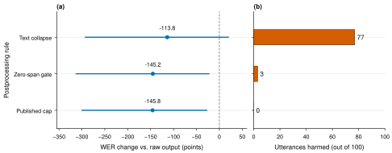

# Cloud ASR study: results and research decision

C. Kaustubh · 13 October 2026 · Prepared for the October 16 review

**Status:** Completed runs below passed independent prediction-level validation. This is an inference study, not a trained-model breakthrough. The Hindi results do not establish Indian-English performance.

## Corrected baseline comparison

Our earlier decoding recipe overstated the room for a custom loop repair. Official Whisper Small scores 60.31% WER on the 405-clip replication set and 62.13% on 396 additional recordings, versus 79.41% and 74.84% with the earlier HF five-beam recipe. The fresh-recording difference is −12.71 points, paired speaker-bootstrap 95% CI [−19.22, −6.72]. These recipes differ in several settings and implementation details; this is not a one-knob attribution.

| Model and decoding recipe | Hindi replication (405) | Hindi fresh audio (396) | Keywords ×1 (100) | Keywords ×5 (100) | Keywords ×8 (100) |
|---|---:|---:|---:|---:|---:|
| Small · HF beam5 | 79.41% | 74.84% | 37.00% | 518.80% | 658.88% |
| Small · official | 60.31% | 62.13% | 26.00% | 24.00% | 36.75% |
| Turbo · HF beam5 | 38.18% | 39.31% | 29.00% | 231.20% | 212.00% |
| Turbo · official | 38.55% | 38.67% | 22.00% | 40.40% | 66.00% |

WER may exceed 100% when insertion errors exceed the reference-word count. All such clips remain in the denominator. Scores use NFC/case/punctuation normalization, without script conversion or numeral equivalence.

## Repairs: aggregate improvement is not preservation

Whisper Turbo HF outputs on the constructed repeated-speech controls:

| Rule | Five-repeat WER | Five-repeat clips harmed | Eight-repeat WER | Eight-repeat clips harmed |
|---|---:|---:|---:|---:|
| Raw output | 231.20% | 0/100 | 212.00% | 0/100 |
| Collapse ≥5 identical words | 117.40% | 77/100 | 92.00% | 74/100 |
| Zero-duration alignment gate | 86.00% | 3/100 | 64.00% | 19/100 |
| Published duration cap | 85.40% | 0/100 | 141.38% | 0/100 |

The text-collapse rule improves pooled five-repeat WER while harming 77/100 clips. A few huge insertion reductions dominate the aggregate. The alignment gate reduces the harm but still damages genuinely supported repetitions. The duration cap is a prior-work baseline and shows no observed clip-level harm on these two constructed sets; this does not prove safety elsewhere.

[Figure with caption](figures/repetition_tradeoff.caption.txt) · [PDF figure](figures/repetition_tradeoff.pdf) · [Offline audio demonstration](demo/index.html)

## Why the loop-only branch is closed for the proper Small baseline

The official Small decoder has **zero five-word-loop triggers across all 801 Hindi recordings**. Any repair constrained to leave a hypothesis unchanged when that trigger is absent must therefore return the original hypothesis on every recording here. Formally, if `T(h_i)=0` for every evaluated `i` and `R(x,h)=h` whenever `T(h)=0`, then `R(x_i,h_i)=h_i` for every `i`; all edit counts and pooled WER are exactly unchanged. This is a finite-sample identity, not a claim that repetition never occurs in other data.

A simulated loop-trigger cascade from HF Small to Turbo scores 61.41% on fresh Hindi, but its difference from official Small has a 95% interval crossing zero [−4.11, +2.91]. It adds a larger model without establishing an improvement over the proper Small baseline. The zero-duration gate on Turbo likewise has a fresh-Hindi gain whose interval reaches zero. Neither is accepted as the research contribution.

## Short-Hindi follow-up

Still running. No short-Hindi quality claims are made until complete artifacts pass validation.

## Limits and reproducibility

The fresh Hindi recordings share speakers with earlier evaluation. No population fairness claim is justified. Repeated-speech controls concatenate recorded words and are not naturally repeated conversation. Silence controls are artificial/calibration floors, cropped explicitly and deduplicated. One decoded run is used per condition; bootstrap intervals describe sampling uncertainty over speakers, not seed variance, and are not multiplicity-adjusted.

All neural inference ran on HF A100 or Modal H100. Hardware differs across recipe comparisons, so their raw timing ratios are not decoder speedups. Per-recording seeds, model/package revisions, code commits, manifests, audio hashes, hypotheses, complete word edits and prediction hashes are saved. The independent validator refuses incomplete bundles, corrupted hashes or mismatched cohorts. Gated references remain private.

[Full aggregate evidence](cloud_decoder_validated_20261013.json) · [Main protocol and prior work](CLOUD_PROTOCOL_20261013.md) · [Validation code](../../scripts/termeval/package_cloud_decoder_study.py) · [Short-study validation](../../scripts/termeval/package_short_hindi_study.py)

## Research decision

The defensible result so far is a decoder-and-evaluation audit: the apparent repair gain depends strongly on the baseline recipe, and pooled WER can conceal deletion of valid repeated speech. This is real, reproducible evidence, but it does not yet establish a novel deployable improvement or guarantee a publication. Keep the properly configured decoder as the baseline, report failed controls, and use any positive short-word result only to justify a separately held-out follow-up. Do not launch training merely to spend the remaining credits.
